# Warranty Risk Prediction Prototype

> **Project status — Prototype complete.**  
> All five pipeline stages are implemented, validated in a clean notebook, and modularized into a Python package with an interactive Streamlit UI. This document describes what has been built, how the system works, and how to run it.
>
> **Extension: Quality Monitoring Agent.** The pipeline is now driven by an agent in four gated phases (Setup, Data, Learning, Operate), with live MQTT scoring, a versioned model registry, multi-seed validation and a test suite. See [Section 7](#7-interactive-ui--streamlit-app) and [Known limitations](#known-limitations). Sections 1-5 describe the original prototype pipeline.

---

## Table of Contents

1. [Motivation](#1-motivation)
2. [Overall Pipeline Architecture](#2-overall-pipeline-architecture)
3. [Pipeline Stages](#3-pipeline-stages)
   - [Stage 1 — Manufacturing Simulation](#stage-1--manufacturing-simulation)
   - [Stage 2 — Warranty Claim Labeling](#stage-2--warranty-claim-labeling)
   - [Stage 3 — Tolerance Optimization](#stage-3--tolerance-optimization)
   - [Stage 4 — Predictive Modeling](#stage-4--predictive-modeling)
   - [Stage 5 — LIME Explanation](#stage-5--lime-explanation)
4. [Plant & Sensor Configuration](#4-plant--sensor-configuration)
5. [Repository Structure](#5-repository-structure)
6. [Python Package — `warranty_risk`](#6-python-package--warranty_risk)
7. [Interactive UI — Streamlit App](#7-interactive-ui--streamlit-app)
8. [How to Run](#8-how-to-run)
9. [Key Design Decisions](#9-key-design-decisions)
10. [Completed Work & Next Steps](#10-completed-work--next-steps)

---

## 1. Motivation

Warranty claims are a significant cost driver in automotive manufacturing. Identifying at-risk vehicles *before* they reach the customer — using manufacturing sensor data — can reduce recall rates, lower warranty reserves, and guide process improvement.

This prototype builds and validates an end-to-end pipeline that:
- Simulates a realistic automotive assembly plant with six sensor-equipped stations
- Labels vehicles with warranty risk using a statistically grounded stochastic model
- Optimizes per-sensor quality tolerances using a Genetic Algorithm
- Trains and evaluates multiple ML classifiers for warranty risk prediction
- Explains individual vehicle predictions using LIME (Local Interpretable Model-agnostic Explanations)

The pipeline is designed to be modular so that each stage can be replaced with real plant data and models as the project matures.

---

## 2. Overall Pipeline Architecture

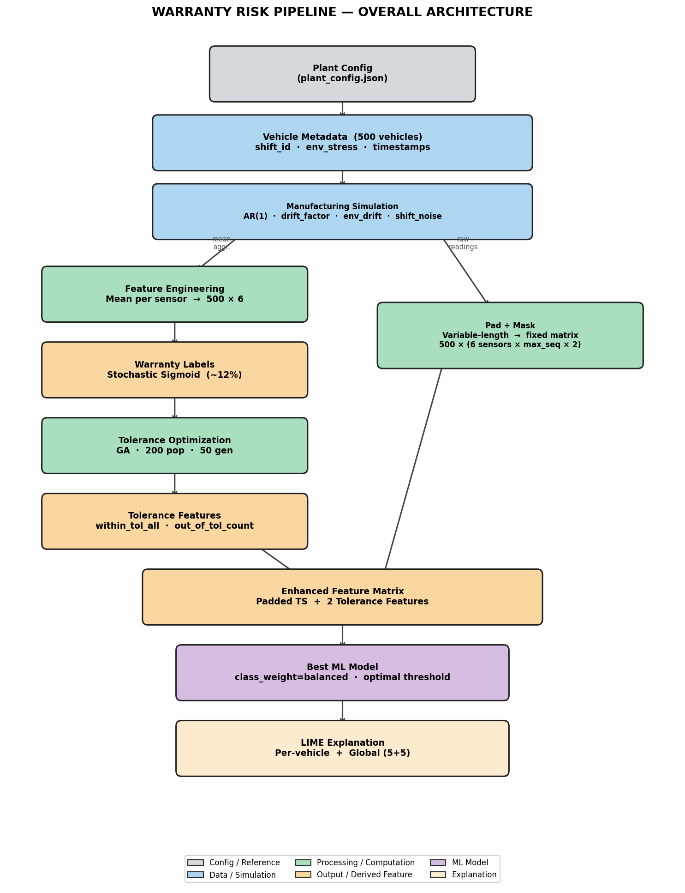

Data flows left-to-right through five stages. The manufacturing simulator produces raw sensor records; these are aggregated into a feature matrix, labeled with warranty risk, enriched with GA-optimized tolerance features, and finally fed to ML models whose predictions are explained by LIME.

---

## 3. Pipeline Stages

### Stage 1 — Manufacturing Simulation

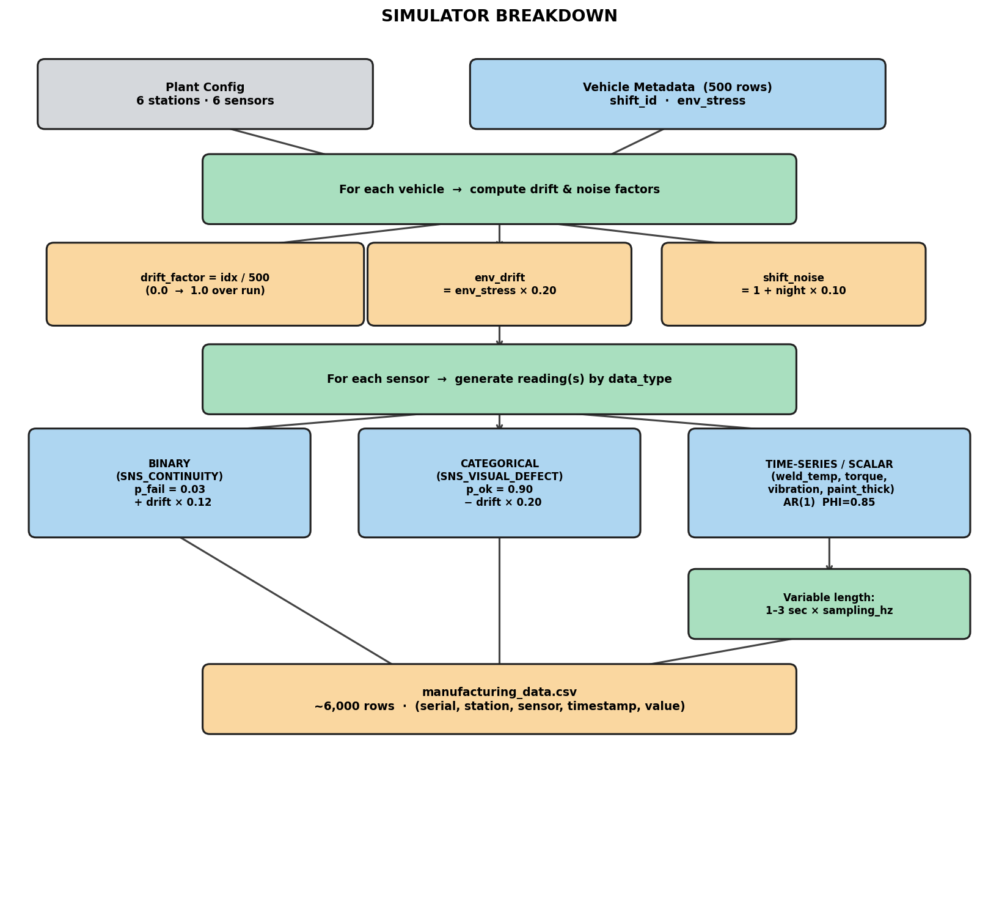

**What it does:** Generates synthetic sensor readings for 500 vehicles passing through 6 assembly stations.

**Key design choices:**

| Factor | Description |
|--------|-------------|
| **AR(1) time-series** | Sensor values follow an autoregressive process: `v[t] = 0.85 × v[t-1] + 0.15 × nominal + noise`. This produces realistic temporal autocorrelation rather than independent random samples. |
| **Drift factor** | Each vehicle accumulates a linear drift as production progresses (`drift = vehicle_index / 500`), simulating gradual process degradation over a production run. |
| **Environmental stress** | 3% of vehicles experience a power-outage event (`env_stress = 1`), which adds an additional 20% drift to all their sensor readings. |
| **Shift noise** | Night-shift vehicles (shift_id = 2) have 10% higher sensor variance, reflecting real-world operator fatigue or calibration drift. |
| **Sensor types** | Three types are supported: *time-series* (multiple readings per vehicle, AR(1)), *scalar* (single reading, AR(1)), *binary* (wiring continuity — Bernoulli with drift-dependent failure rate), *categorical* (visual defect — ok / minor / major with drift-dependent probabilities). |

**Output:** `data/raw/manufacturing_data.csv` — ~18,400 rows (500 vehicles × 6 sensors × variable readings per sensor).

---

### Stage 2 — Warranty Claim Labeling

**What it does:** Assigns a binary warranty claim label (0/1) to each vehicle based on a stochastic sigmoid function of sensor risk.

**How it works:**

```
risk_seed  = w₁ × Vibration + w₂ × Torque + w₃ × Weld Temp
             + w₄ × Visual Defect + w₅ × Wiring Continuity
risk_norm  = (risk_seed − min) / (max − min)          ← normalize to [0, 1]
p_claim    = sigmoid(k × (risk_norm − threshold))     ← k=10, threshold scanned adaptively
claim      ~ Binomial(1, p_claim)                     ← stochastic draw
```

Paint thickness is excluded from the risk score because cosmetic variation has low correlation with functional warranty claims.

The threshold is scanned adaptively (0.50 → 0.98) until the expected claim rate is ≤ 12%, producing a realistic ~10% minority class.

**Output:** `data/raw/manufacturing_warranty_data.csv` — sensor records with `warranty_claim` column appended.

---

### Stage 3 — Tolerance Optimization

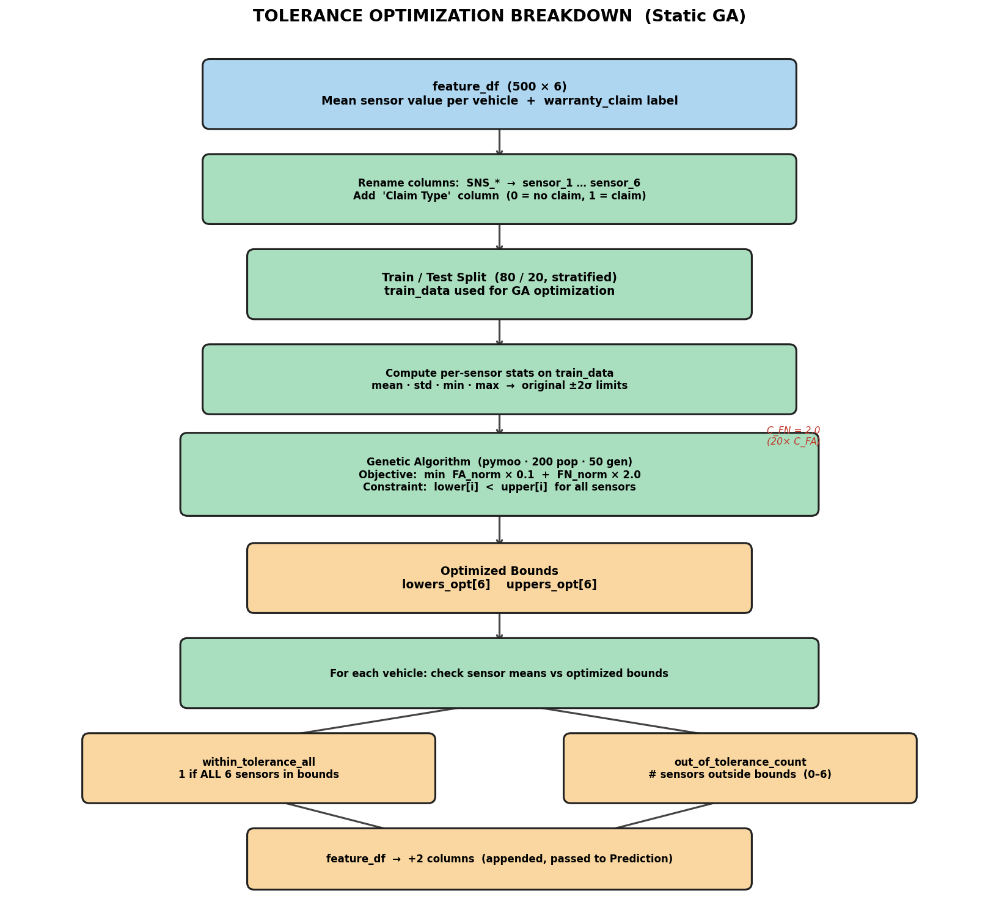

**What it does:** Uses a Genetic Algorithm (GA) to find the tightest per-sensor tolerance window [lower, upper] that minimizes the total cost of quality failures.

**Cost model:**

| Failure type | Meaning | Cost weight |
|---|---|---|
| **False Accept (FA)** | Vehicle passes all tolerances but later makes a warranty claim | `C_FA = 0.1` per claim type |
| **False Reject (FN)** | Vehicle fails a tolerance but would not have made a claim (unnecessary rework) | `C_FN = 2.0` per claim type |

FN is weighted 20× higher than FA because unnecessary rework is more expensive than the risk of accepting a borderline vehicle.

**GA configuration:**

| Parameter | Value |
|---|---|
| Library | [pymoo](https://pymoo.org/) |
| Algorithm | Single-objective GA |
| Population size | 200 |
| Generations | 50 |
| Crossover | SBX (η=15, p=0.9) |
| Mutation | Polynomial (η=20, p=0.2) |

The GA optimizes 2N decision variables (N lower bounds + N upper bounds for N sensors) subject to the constraint `lower[i] < upper[i]` for all sensors.

**Tolerance features added to the feature matrix:**

| Feature | Description |
|---|---|
| `within_tolerance_all` | 1 if all sensor means are within their optimized bounds, else 0 |
| `out_of_tolerance_count` | Number of sensors (0–6) whose mean falls outside optimized bounds |

**Output:** Optimized bounds table; two new columns appended to the feature matrix.

---

### Stage 4 — Predictive Modeling

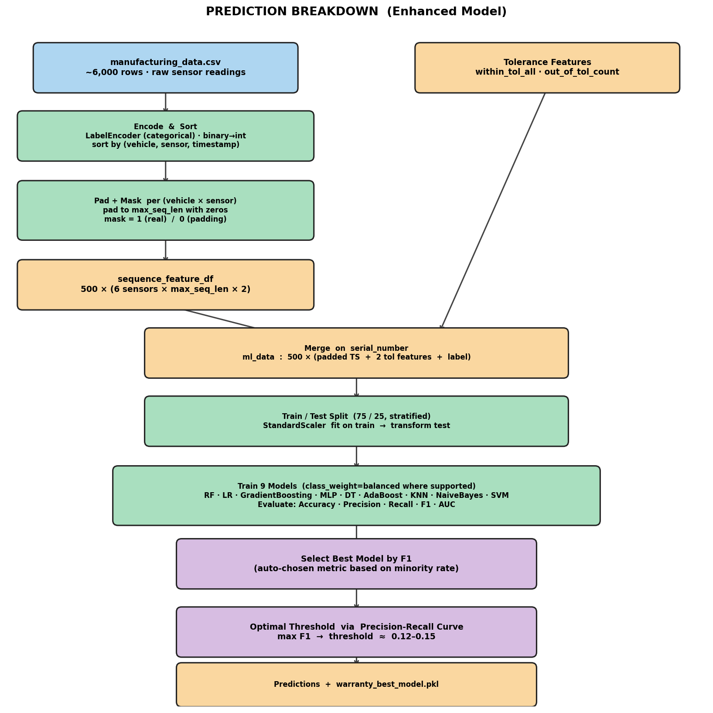

**What it does:** Trains 9 classifiers to predict warranty claims and selects the best by F1 score. Evaluates baseline (time-series features only) vs. enhanced (time-series + tolerance features) to quantify the value added by Stage 3.

**Feature engineering — padding & masking:**  
Because time-series sensors produce a variable number of readings per vehicle, all sequences are zero-padded to the maximum observed length. A binary mask column (`sensor_t{i}_mask`) records which positions contain real measurements vs. padding. This preserves temporal structure without discarding information.

**Models evaluated:**

| Model | Notes |
|---|---|
| Random Forest | `class_weight="balanced"` |
| Gradient Boosting | — |
| Logistic Regression | `class_weight="balanced"`, scaled |
| MLP (64→32) | Scaled |
| Decision Tree | `class_weight="balanced"` |
| AdaBoost | — |
| KNN (k=5) | Scaled |
| Naive Bayes | — |
| SVM (RBF) | `class_weight="balanced"`, scaled |

**Class imbalance handling:**  
`class_weight="balanced"` prevents models from predicting all-zeros on the ~12% minority class. The decision threshold is also moved from the default 0.5 to an optimal value computed from the precision-recall curve on the **validation** vehicles (maximizing F1), typically landing near 0.12–0.15. Vehicles are split 60 / 20 / 20 into train / validation / test before any fitting; the GA tolerance bounds use train vehicles only, the best model is chosen on validation, and the reported metrics come from the test vehicles.

**Baseline vs. Enhanced comparison:**  
Both variants use `clone(best_model)` — an identical, freshly initialized copy of whichever model won the leaderboard — so any metric difference is attributable purely to the addition of the two tolerance features.

**Output:** Model leaderboard sorted by F1; confusion matrices and ROC curves for both variants (`outputs/plots/baseline_vs_enhanced.png`).

---

### Stage 5 — LIME Explanation

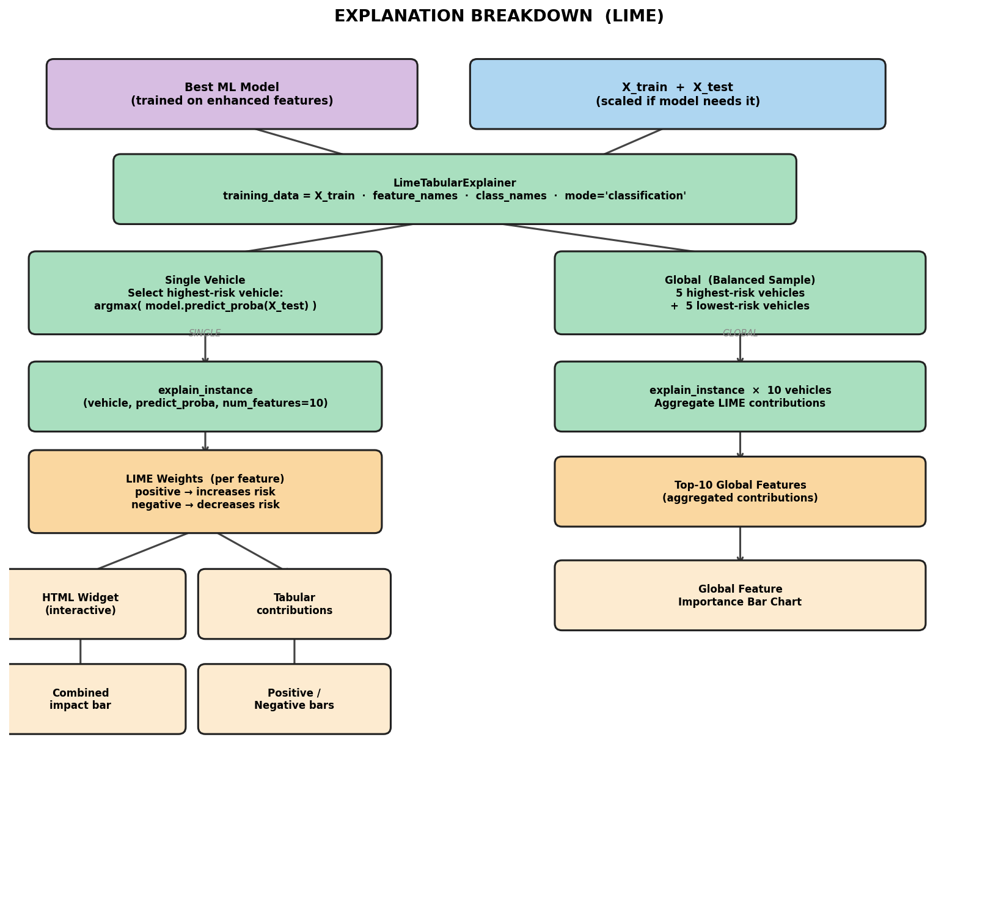

**What it does:** Provides human-interpretable explanations of individual vehicle warranty predictions.

**How LIME works:** For a given vehicle, LIME fits a simple local linear model in the neighborhood of that vehicle's feature vector. The linear coefficients are the "feature importances" — positive weights increase predicted risk, negative weights decrease it.

**Two explanation modes:**

| Mode | What it shows |
|---|---|
| **Single vehicle** | Top 10 features for the highest-risk vehicle: combined bar chart, risk-increasing (orange), risk-decreasing (blue) |
| **Global (balanced)** | Mean LIME weights aggregated over 5 high-risk + 5 low-risk vehicles — shows which features matter most across the test set |

**Output:** LIME bar charts in `outputs/plots/`; interactive HTML explanation in `outputs/plots/lime_explanation.html`.

---

## 3b. Sample Results

### Architecture Diagrams

All five architecture diagrams are embedded inline within their respective pipeline stage sections above. The plant station configuration diagram is in Section 4.

---

### Stage 3 — Tolerance Optimization Results

**Original vs. Optimized Limits**

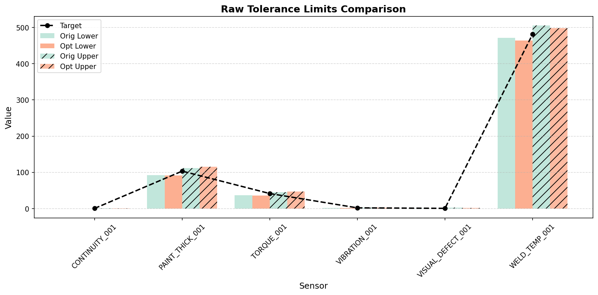

Grouped bars show original (±2σ) limits vs. GA-optimized limits per sensor. The dashed line is the optimized target (midpoint of bounds).

---

**Normalized Z-Score Ranges**

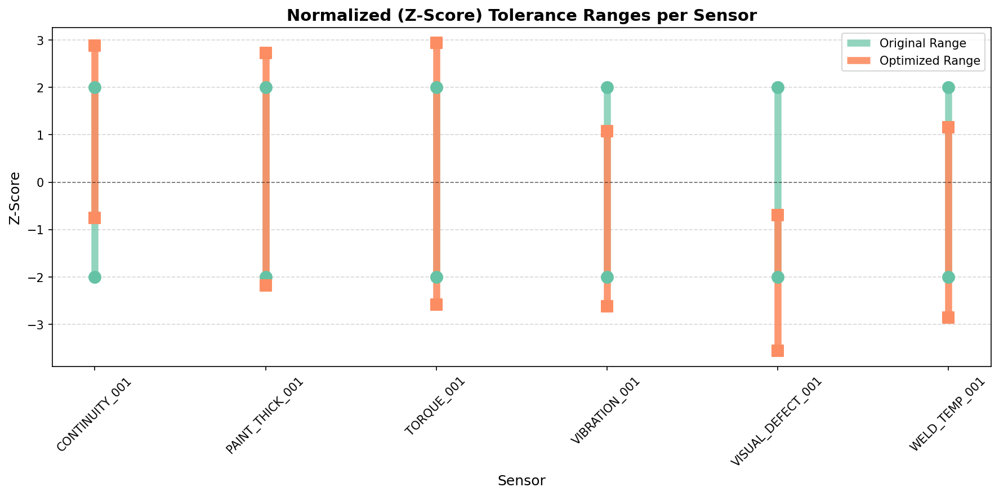

Tolerance windows expressed in standard deviations from the sensor mean, allowing direct comparison across sensors with different physical units.

---

**Per-Sensor Tolerance Violations**

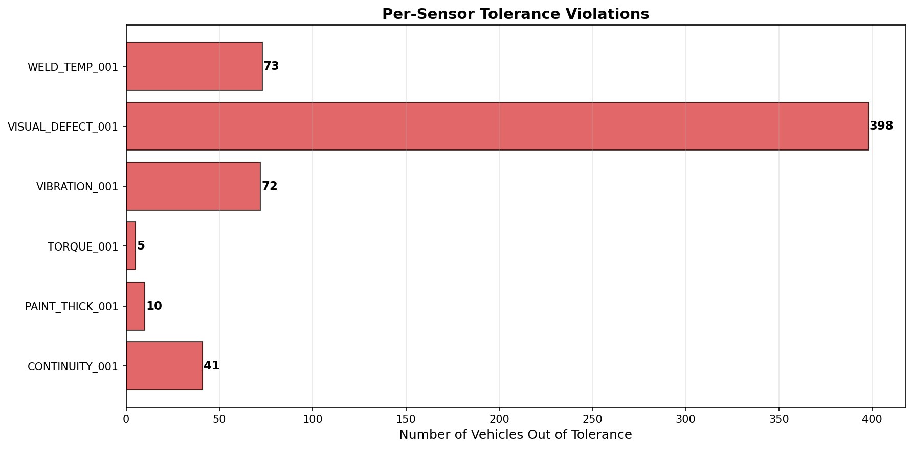

Number of vehicles whose mean sensor value falls outside the optimized bounds for each sensor. Red = violations present, green = no violations.

---

**Overall Vehicle Tolerance Status**

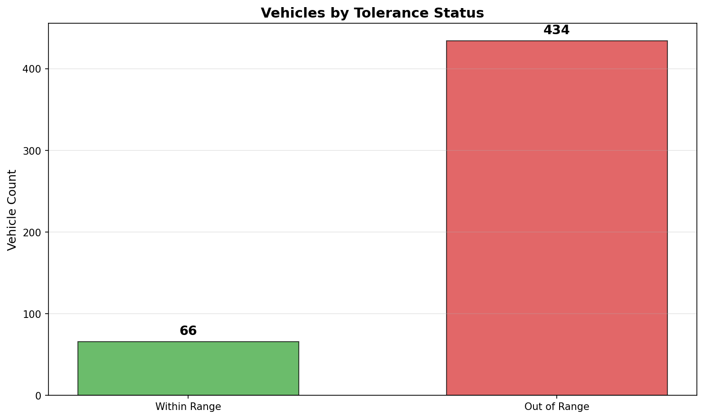

Count of vehicles that pass all six sensor tolerances simultaneously vs. those with at least one out-of-bounds sensor.

---

**Data Distribution vs. Optimized Limits**

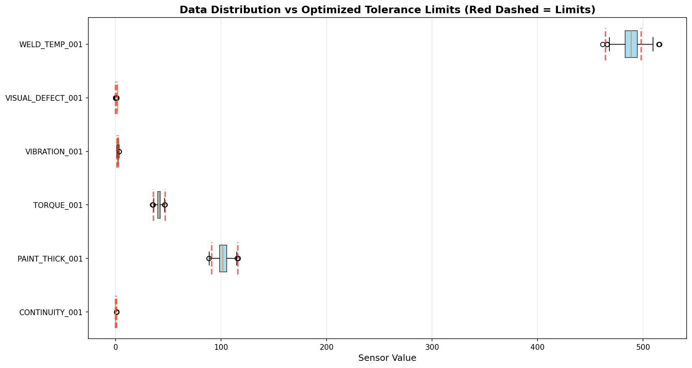

Box plots of the full vehicle population per sensor. Red dashed lines mark the GA-optimized lower and upper bounds.

---

### Stage 4 — Prediction Results

**Baseline vs. Enhanced Comparison**

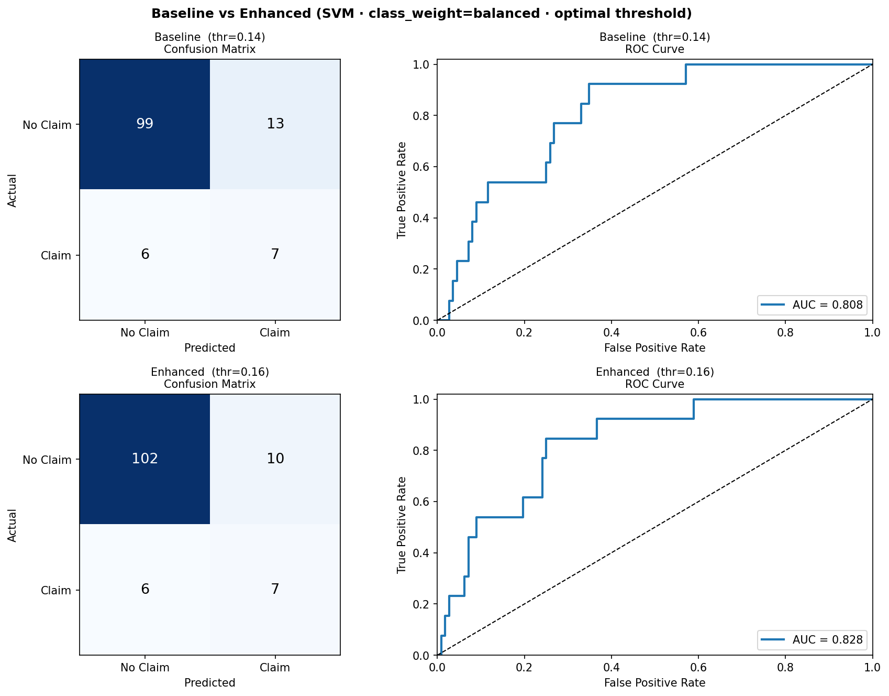

Left column: Baseline model (time-series features only). Right column: Enhanced model (time-series + two GA-derived tolerance features). Confusion matrices and ROC curves show the improvement in recall and AUC from adding tolerance information.

---

### Stage 5 — LIME Explanation Results

**Single Vehicle — Highest-Risk Vehicle**

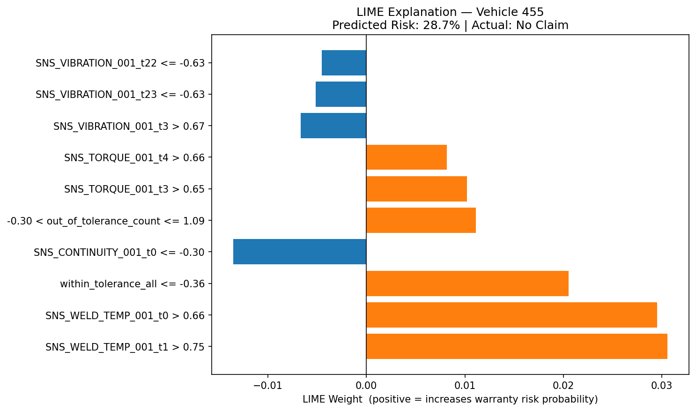

Three-panel LIME chart for the highest-risk vehicle in the test set: combined impact (left), risk-increasing features in orange (center), risk-decreasing features in blue (right).

---

**Global LIME — Aggregated Feature Importance**

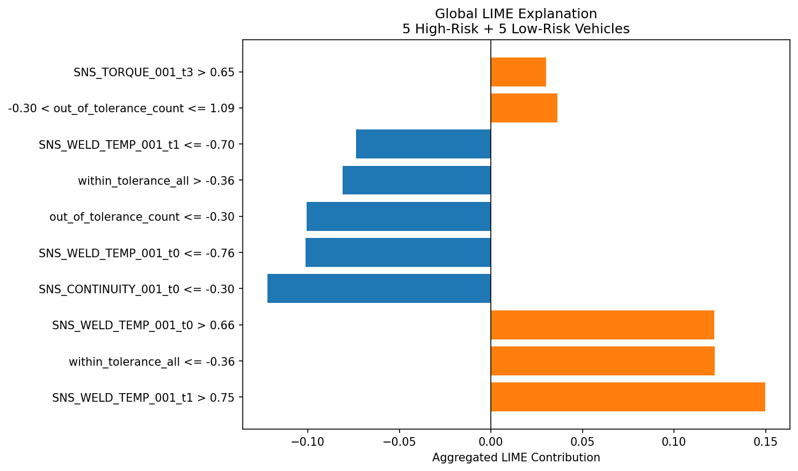

Aggregated LIME weights over 5 high-risk + 5 low-risk test vehicles. Orange bars increase warranty risk; blue bars decrease it. Features with the largest absolute weight are the most influential across the test set.

---

## 4. Plant & Sensor Configuration

### Station Layout

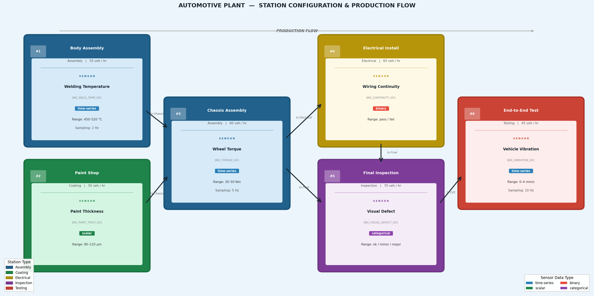

Each station is color-coded by type. Arrows show the production flow as defined in `plant_config.json`. Both Body Assembly and Paint Shop feed into Chassis Assembly; Chassis Assembly branches to both Electrical Install and Final Inspection; these converge at Final Inspection before the vehicle reaches End-to-End Test.

The plant is defined in `data/config/plant_config.json`. Six stations are arranged in the following order:

```
STN_BODY (Body Assembly)
    └─► STN_CHASSIS (Chassis Assembly)
            ├─► STN_ELECTRICAL (Electrical Install)
            │       └─► STN_FINAL (Final Inspection)
            │                └─► STN_E2E (End-to-End Test)
            └─► STN_FINAL
STN_PAINT (Paint Shop)
    └─► STN_CHASSIS
```

**Sensors:**

| Station | Sensor | Type | Range / Unit | Sampling |
|---|---|---|---|---|
| Body Assembly | Welding Temperature | Time-series | 450–520 °C | 2 Hz |
| Paint Shop | Paint Thickness | Scalar | 80–120 µm | — |
| Chassis Assembly | Wheel Torque | Time-series | 30–50 Nm | 5 Hz |
| Electrical Install | Wiring Continuity | Binary | pass/fail | — |
| Final Inspection | Visual Defect | Categorical | ok/minor/major | — |
| End-to-End Test | Vehicle Vibration | Time-series | 0–4 mm/s | 10 Hz |

---

## 5. Repository Structure

```
warranty-risk-prototype/
│
├── data/
│   ├── config/
│   │   └── plant_config.json              ← Plant and sensor configuration
│   └── raw/
│       ├── vehicle_metadata.csv           ← 500 vehicles (generated)
│       ├── manufacturing_data.csv         ← ~18,400 sensor records
│       └── manufacturing_warranty_data.csv ← sensor records + warranty_claim
│
├── outputs/
│   ├── diagrams/                          ← 6 architecture & plant diagrams (PNG)
│   │   ├── 01_overall_pipeline.png
│   │   ├── 02_simulator_breakdown.png
│   │   ├── 03_tolerance_optimization.png
│   │   ├── 04_prediction_breakdown.png
│   │   ├── 05_lime_explanation.png
│   │   └── 06_plant_station_config.png
│   └── plots/                             ← All pipeline result visualizations (PNG)
│       ├── tolerance_limits_comparison.png
│       ├── tolerance_zscore_comparison.png
│       ├── tolerance_violations_per_sensor.png
│       ├── tolerance_vehicle_status.png
│       ├── tolerance_distribution_vs_limits.png
│       ├── baseline_vs_enhanced.png
│       ├── lime_instance_explanation.png
│       └── lime_global_balanced.png
│
├── warranty_risk_app/                     ← Modular Python package + Streamlit UI
│   ├── app.py                             ← Streamlit app (four-phase agent UI)
│   ├── stream_quality_agent.py            ← Live MQTT scoring runner
│   ├── mock_publisher.py                  ← Publishes simulated vehicles to MQTT for testing
│   ├── requirements.txt
│   ├── tests/                             ← pytest suite (run from warranty_risk_app/)
│   └── warranty_risk/                     ← Python package
│       ├── config.py
│       ├── pipeline.py                    ← End-to-end orchestrator (+ score_new_vehicle)
│       ├── agent/                         ← Quality Monitoring Agent
│       │   ├── orchestrator.py            ← Setup / Data / Learning / Operate phases
│       │   ├── config_validator.py, data_validator.py, diagram.py
│       │   ├── mqtt_listener.py, alerting.py   ← Live stream scoring and alerts
│       │   ├── model_registry.py          ← Versioned model + preprocessing saves
│       │   ├── validation.py              ← Multi-seed mean ± std and baseline
│       │   ├── feedback.py                ← Risk-weight adjustment (see Known limitations)
│       │   └── narration.py, audit_log.py
│       ├── preprocessing/
│       │   ├── preprocessor.py            ← Preprocessor (fit/transform) and auto_preprocess
│       │   └── encoding.py                ← Shared categorical code map (train = live)
│       ├── labels/
│       │   ├── features.py
│       │   └── sigmoid.py
│       ├── optimization/
│       │   ├── ga_optimizer.py
│       │   └── tolerance_features.py
│       ├── prediction/
│       │   ├── padding.py
│       │   └── models.py
│       └── explanation/
│           └── lime_explainer.py
│
├── plant_simulator_pkg/                   ← Optional simulator package (pip install -e)
│   └── plant_simulator/                   ←   vehicle.py, manufacturing.py
│
├── requirements.txt                       ← Root-level dependencies
└── README.md
```

---

## 6. Python Package — `warranty_risk`

The pipeline logic is fully encapsulated in the `warranty_risk` package under `warranty_risk_app/`. Each module is independently importable and returns pure data structures (DataFrames, arrays, dicts) with no global state.

| Module | Key function / class | What it returns |
|---|---|---|
| `config` | `load_config()`, `get_stations()` | Plant config dict, stations list |
| `plant_simulator` (separate package) | `generate_vehicle_metadata(n)`, `generate_manufacturing_data(...)` | Simulated vehicles and raw sensor records |
| `preprocessing.preprocessor` | `Preprocessor(label_col).fit(train).transform(df)` | Cleaned DataFrame; imputation and column drops learned from `fit` data only |
| `preprocessing.encoding` | `fit_category_map(df)`, `encode_values(df, map)` | Categorical codes shared by training and live scoring |
| `labels.features` | `build_feature_matrix(manufacturing_df)` | DataFrame: one row per vehicle, one col per sensor |
| `labels.sigmoid` | `generate_warranty_labels(feature_df)` | `(feature_df_with_label, meta_dict)` |
| `optimization.ga_optimizer` | `run_ga_optimization(...)` | Dict with optimized bounds and GA stats |
| `optimization.tolerance_features` | `compute_tolerance_features(...)` | feature_df with 2 new tolerance columns |
| `prediction.padding` | `build_padded_matrix(manufacturing_df, feature_df, category_map)` | Wide feature matrix with time-step columns |
| `prediction.padding` | `pad_single_vehicle(readings, sensor_uids, max_seq_len, category_map)` | One live vehicle in the trained column layout |
| `prediction.models` | `train_and_select(ml_data)` | Best model, all metrics, train/test splits |
| `prediction.models` | `compare_baseline_enhanced(train_result)` | Metrics for both variants |
| `explanation.lime_explainer` | `explain_vehicle(...)` | LIME DataFrame + probability |
| `explanation.lime_explainer` | `global_lime(...)` | Aggregated feature weights + chart |
| `pipeline` | `WarrantyRiskPipeline().run()` | All artifacts as instance attributes |
| `pipeline` | `score_new_vehicle(readings_df)` | Probability + LIME for one new vehicle |
| `agent.orchestrator` | `QualityMonitoringAgent` | Phase-gated Setup / Data / Learning / Operate |
| `agent.model_registry` | `save(...)`, `load_latest()` | Versioned model, scaler and preprocessing metadata |

**Using the orchestrator in a script or notebook:**

```python
import sys
sys.path.insert(0, "warranty_risk_app")

from warranty_risk.pipeline import WarrantyRiskPipeline

pipe = WarrantyRiskPipeline(n_vehicles=500, n_generations=50)
pipe.run()

print(pipe.results_df)               # Model leaderboard
print(pipe.lime_result["lime_df"])   # LIME table for highest-risk vehicle
print(pipe.label_meta)               # Claim rate, sigmoid threshold
print(pipe.ga_result["df_results"])  # Optimized tolerance limits
```

---

## 7. Interactive UI — Streamlit App

The Streamlit app provides a browser-based interface to run the full pipeline and inspect results at each stage without writing any code.

The app is driven by `QualityMonitoringAgent` in four gated phases; each phase unlocks only after the previous one is confirmed:

| Phase | What happens |
|---|---|
| 1 · Setup | Register the facility (`plant_config.json` or upload); the config is validated, drawn as a station diagram, and must be confirmed by the user |
| 2 · Data | Upload real data (checked against the registered sensors and cleaned by `auto_preprocess`) or simulate it with the optional `plant_simulator` package |
| 3 · Learning | GA tolerance optimization, 9-model training and selection, multi-seed validation, model saved to the registry |
| 4 · Operate | Score a vehicle, LIME explanation, recommended action; live vehicles can be scored from an MQTT stream |

Every phase is narrated in plain language (optionally via the Gemini API, with a deterministic fallback) and recorded in an audit log.

Run parameters in the app include vehicle count, GA generations, GA population size, and cost weights (C_FA, C_FN) before running.

---

## 8. How to Run

### Prerequisites

- Python 3.10 or 3.11
- Terminal open at the **repository root** (`warranty-risk-prototype/`)

### Step 1 — Create a virtual environment

```bash
python -m venv .venv
source .venv/bin/activate        # macOS / Linux
# .venv\Scripts\activate         # Windows
```

### Step 2 — Install dependencies

```bash
pip install -r warranty_risk_app/requirements.txt
```

This also installs the optional simulator (`-e ../plant_simulator_pkg`). To run the test suite:

```bash
cd warranty_risk_app
python -m pytest tests/
```

### Step 3 — Launch the Streamlit app

```bash
streamlit run warranty_risk_app/app.py
```

The browser opens automatically at `http://localhost:8501`. Work through the phases in order (confirm the setup, provide data, run Learning). Learning takes approximately 1–2 minutes (dominated by GA optimization and model training).

For live scoring, start an MQTT broker, run `warranty_risk_app/stream_quality_agent.py`, and use `warranty_risk_app/mock_publisher.py` to publish simulated vehicles.

### Running via the Python package directly

```python
import sys
sys.path.insert(0, "warranty_risk_app")

from warranty_risk.pipeline import WarrantyRiskPipeline

pipe = WarrantyRiskPipeline(n_vehicles=500, n_generations=50)
pipe.run()
print(pipe.results_df)
```

---

## 9. Key Design Decisions

| Decision | Choice | Rationale |
|---|---|---|
| **Label generation** | Stochastic sigmoid (not NN or top-N%) | Eliminates circular dependency; gives downstream ML a genuine learning task |
| **Sensor simulation** | AR(1) with drift, env stress, shift noise | Interpretable, parameterized; captures realistic process variation without requiring historical data |
| **Claim rate target** | ~10% (minority class) | Reflects realistic automotive warranty rates; imbalance handled algorithmically |
| **Class imbalance** | `class_weight="balanced"` + optimal threshold | Prevents degenerate all-zeros predictions; threshold tuned to maximize F1 |
| **Tolerance optimization** | Static GA bounds (not adaptive/real-time) | Bounds computed once from training data; suitable for offline process qualification |
| **Model selection** | F1 score (not accuracy) | Accuracy is misleading at ~12% class prevalence; F1 balances precision and recall |
| **Baseline vs. Enhanced** | `clone(best_model)` for both | Ensures the comparison isolates the effect of tolerance features, not model differences |
| **Categorical encoding** | One code map fitted at training, saved with the model | A per-batch `LabelEncoder` gives a live vehicle different codes than training did |
| **Preprocessing** | `Preprocessor` fit/transform | Imputation values and dropped columns come from training data only |
| **GA optimizer code** | Preserved verbatim from original `.py` file | Maintains consistency with the validated algorithm from prior work |

---

## 10. Completed Work & Next Steps

### What is complete

- [x] Synthetic plant and sensor configuration (`plant_config.json`)
- [x] Vehicle and manufacturing data simulator with environmental factors (shift noise, power-outage drift)
- [x] Stochastic sigmoid warranty label generation (no circular dependency)
- [x] GA-based tolerance optimization using pymoo
- [x] Tolerance feature engineering (within-bounds flag and out-of-bounds count)
- [x] Variable-length time-series padding and masking
- [x] 9-model classifier evaluation with class-imbalance handling and optimal threshold selection
- [x] Baseline vs. Enhanced comparison using identical model architecture (`clone`)
- [x] LIME explanations — single vehicle (3-panel) and global (balanced sample)
- [x] Clean end-to-end notebook (`05_pipeline_clean.ipynb`)
- [x] Architecture diagrams for all five pipeline stages
- [x] Modular Python package (`warranty_risk_app/warranty_risk/`)
- [x] Streamlit interactive UI with configurable parameters
- [x] Quality Monitoring Agent: four gated phases, config and data validation, narration, audit log
- [x] Optional `plant_simulator` package, separate from the application
- [x] Live scoring of a single vehicle and MQTT listener with alerting
- [x] Versioned model registry (model, scaler, category map, padding layout)
- [x] Multi-seed validation (mean ± std) with a baseline comparison
- [x] Shared categorical encoding and fit/transform `Preprocessor`
- [x] pytest suite
- [x] Leakage-free evaluation: vehicles split into train / validation / test before any fitting; the GA is fit on train only; model and threshold are chosen on validation; metrics are reported on the untouched test vehicles; `validate()` repeats the whole procedure per seed. Regression tests in `tests/test_leakage_free.py`.

### Known limitations

These affect how far the reported metrics can be trusted and should be fixed before quoting results:

- **Small test set.** Vehicles are split 60 / 20 / 20 (train / validation / test) before any fitting, so with ~500 vehicles and a ~10% claim rate the test set holds only ~10 claims. Metrics are leakage-free but noisy; use the multi-seed `validate()` mean ± std, not a single run.
- **Threshold is not cost-based.** The decision threshold maximises validation F1 and ignores the false-alarm / missed-defect costs (`c_fa`, `c_fn`) that the GA uses.
- **Synthetic labels.** Claims are generated from the same sensors the model sees, so performance on simulated data measures how well the label function is recovered, not real warranty risk. (The generator is now seeded, so runs are reproducible.)
- **Self-reinforcing feedback.** `agent/feedback.py` adjusts sensor risk weights from correlation with claim labels on all vehicles; with simulated labels, those weights also generate the labels. It does not yet use held-out vehicles or distinguish real from simulated labels.
- **Partial vehicles.** A vehicle still moving down the line is scored with unreached stations zero-filled, so its score is not reliable.
- **Upload path.** Uploaded data is validated and cleaned but is not yet carried through to Learning.

### Possible next steps

- [ ] **Cost-based threshold**: choose the decision threshold from `c_fa` / `c_fn` on validation instead of F1
- [ ] **Feedback on real labels only**: adjust risk weights only from real claims, measured on held-out vehicles
- [ ] **Partial-vehicle scoring**: train on truncated station prefixes or use a sequence model

- [ ] **Real Plant Data Integration** — Replace the simulator with actual plant sensor feeds; the package API accepts any DataFrame matching the expected schema
- [ ] **End-to-End Pipeline Adaptation for Live Data** — Adapt preprocessing, feature engineering, tolerance optimization, and model retraining to handle the characteristics of real sensor data (noise, missing readings, calibration drift)
- [ ] **Multi-Facility Scalability** — Parameterize the plant config to support multiple facilities with different station layouts and sensor configurations
- [ ] **Multi-Category Warranty Classification** — Extend the label schema from binary (claim / no-claim) to multi-class warranty categories aligned with real claim codes, enabling more targeted root-cause diagnosis

---

*Prototype developed as part of grant research on predictive quality management in automotive manufacturing.*

---

**Developed by:** Noor-E Jannat, PhD Candidate  
Industrial & Systems Engineering (ISE) Department, Wayne State University

**Extended by:** Sravani B: Quality Monitoring Agent, live scoring, model registry, validation, shared encoding and fit/transform preprocessing
